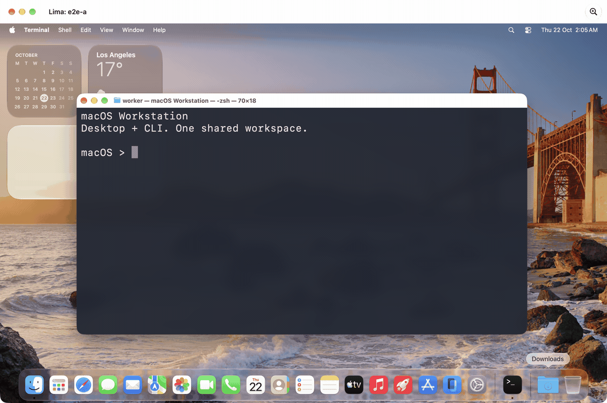

# macOS Workstation Skill

**另一套 macOS，融入你正在用的 Mac。**

桌面随手打开，命令行留在当前终端。在独立 macOS 中运行浏览器、应用和开发工具，也能直接从宿主调用它的命令，结果回到手边——无需来回切换窗口、手动连接 SSH 或反复搬运项目文件。

- **桌面与命令行一体**：打开完整 macOS 桌面，或在宿主终端进入同一套系统。
- **项目接着用**：多个目录共享、双向剪贴板，让两套系统衔接到同一份工作。
- **环境独立，检查内置**：专用代理、断流保护和网络验收随工作站一起配置。



*候选实例真实桌面与命令输出。日常也可直接在宿主终端调用同一系统，见下方用法。[静态截图](docs/images/workstation-desktop.png)*

适用于 Apple Silicon Mac。基线：Lima 2.3.0-beta.1 · sing-box 1.14.3 · macOS 27 客户机。

## 使用方式

安装并完成验收后，在 Skill 目录执行：

```sh
# 启动 macOS 桌面
python3 scripts/workstation.py --config /absolute/private/profile.json start

# 从宿主终端进入虚拟机命令行
python3 scripts/workstation.py --config /absolute/private/profile.json shell

# 直接调用虚拟机命令，结果回到当前终端
python3 scripts/workstation.py --config /absolute/private/profile.json shell -- sw_vers

# 正常关闭
python3 scripts/workstation.py --config /absolute/private/profile.json stop
```

桌面和命令行使用同一个系统、代理和共享项目目录。日常 CLI 操作无需切换到虚拟机窗口；启动和进入命令行时自动检查网络状态。

**Lima 预览版说明：** 当前使用 `2.3.0-beta.1`，上游对 macOS 客户机的支持仍属实验性质，安装、启动及桌面集成可能不稳定。本项目提供配置与验收流程，底层虚拟化兼容性仍依赖 Lima 后续修复。

## AI 执行入口

先读 [SKILL.md](SKILL.md)，按任务读取对应文档：

- [安装](references/install.md)：依赖、私有配置、节点、首次启动。
- [验收](references/acceptance.md)：代理、断流、冷启动、共享、浏览器与剪贴板。
- [维护](references/maintenance.md)：日常操作和共享调整。

命令在本目录执行，配置参考 [profile.json](examples/profile.json)，实际配置和节点保存在包外。

```sh
python3 scripts/workstation.py --config /absolute/private/profile.json <command>
```

新建顺序：`validate` → `bootstrap` → 客户机管理员完成网络安装、安装 Chrome 并登录桌面 → `accept` → 登录桌面 → `finish-acceptance` → 用户确认双向剪贴板 → `confirm-ui`。

日常命令：`start`、`stop`、`shell`、`check`。本版本聚焦新建、验收与日常使用。

## 必测项

- 代理：预期出口、物理接口和路由、宿主 Clash/Mihomo 出口对比。
- 隔离：IPv4/IPv6、宿主代理与 DNS 绕路阻断；两种断流故障及恢复。
- 冷启动：网络保护、多目录读写策略、双向剪贴板。
- 浏览器：HTTPS、两台 STUN、WebGL。

检查失败不放行；实例、配置、节点或脚本变化后重新验收。

## 安装与状态

将本目录放入 `~/.codex/skills/macos-workstation` 或 `~/.claude/skills/macos-workstation`，也可直接引用本目录的 SKILL.md。

当前为开源预览版：27 项离线测试通过；候选 A 已完成新建端到端验收，随后新增的预检查、续跑和失败收尾优化尚未重新安装实测。重建与回退不在本版本交付范围。详见 [验证状态](references/validation.md)。

许可证：[MIT](LICENSE)。
